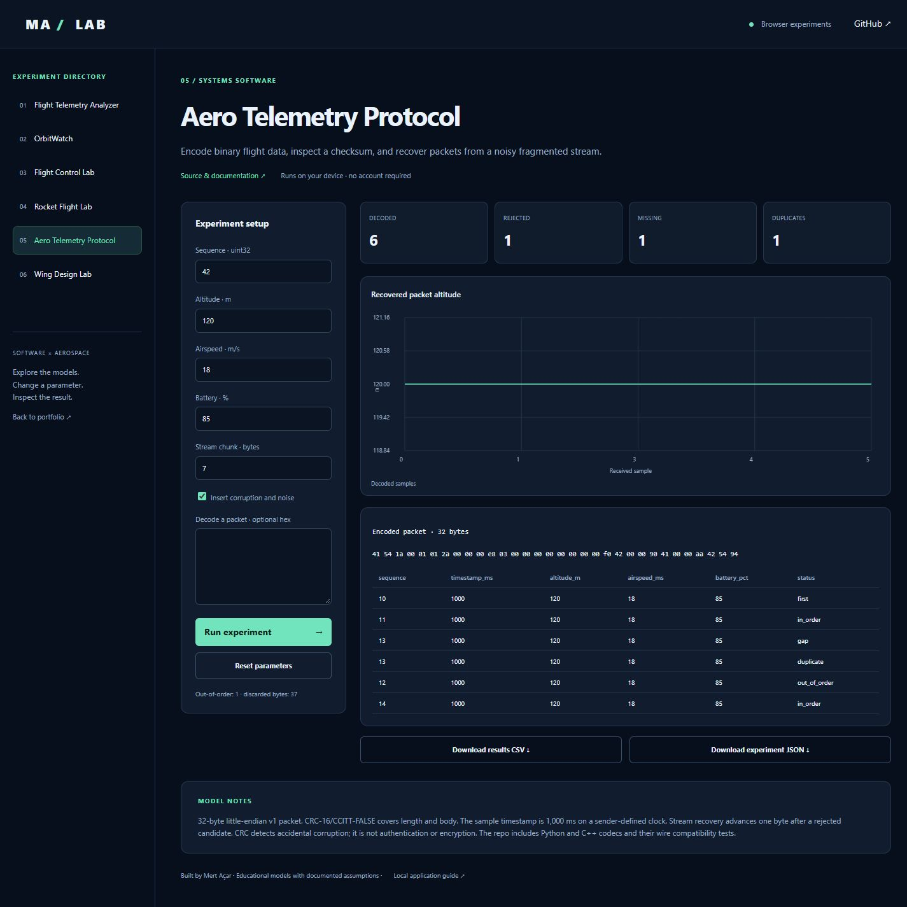

# Aero Telemetry Protocol

[Live browser demo](https://mertacar-git.github.io/aero-telemetry-protocol/) · [Portfolio laboratory](https://mertacar-git.github.io/portfolio/lab/index.html?project=aero-telemetry-protocol)

<details>
<summary>Actual application screenshot</summary>



</details>

[Short demo video](docs/demo.mp4) — a timed walkthrough of actual default and changed-parameter screenshots.

## Browser and local editions

The public browser demo runs JavaScript models on-device. The local application uses Python and Streamlit. JavaScript numerical/protocol outputs are checked against committed Python reference fixtures. Satellite.js 6.0.1 is bundled with its license; no runtime CDN is required. Uploaded CSV data is processed locally in the browser.

Browser orbit crossings use sampling and bisection, with sampled culmination times; local Skyfield uses its event search. Browser rocket inputs use constant thrust; local Python also supports uploaded thrust curves. Browser wing coefficients are fixed to CD0=0.025 and CLmax=1.2; local Python exposes these and a span sweep. Browser telemetry has CSV/JSON analysis; local Python additionally groups alert intervals.

```sh
node --test docs/models.test.cjs
```

Serve `docs/` with any static server to run the browser edition locally. Example: `python -m http.server 8000 --directory docs`. Open http://localhost:8000.

## Features

- Documented 32-byte little-endian packet specification with sender-defined monotonic timestamps.
- CRC-16/CCITT-FALSE and finite float32 measurement validation.
- Reference Python and portable C++17 codecs; noise recovery and arbitrary stream fragmentation.
- Sequence gaps, wraparound, duplicate and out-of-order detection in the Python reference and browser diagnostics.
- Interactive packet editor, hex decoder and corrupted-stream demonstration.

See [WIRE_FORMAT.md](WIRE_FORMAT.md) for offsets, CRC coverage and protocol semantics. CRC detects accidental corruption and does not authenticate data. The C++ header requires IEEE-754 32-bit floats; the Python/JS/C++ golden packet is checked in CI. The C++ codec includes streaming recovery; sequence diagnostics are implemented in Python/JavaScript.

## C++ build

```sh
cmake -S . -B build -DCMAKE_BUILD_TYPE=Debug
cmake --build build
ctest --test-dir build --output-on-failure
# Linux/macOS:
python verify_cpp.py build/codec_test
# Windows multi-config generators: pass build/Debug/codec_test.exe instead.
```

The native tests use assertions; run a Debug build so assertions remain enabled. Python tests exercise every possible packet fragment size, CRC corruption, resynchronization, malformed length and sequence wrap. Browser encoding uses safe integer timestamp inputs; decoding displays uint64 timestamps as strings.


Educational aerospace/software project with an interactive application and validated core.

## Run locally

Python 3.12 recommended.

```sh
python -m venv .venv
# Windows: .venv\Scripts\activate
# macOS/Linux: source .venv/bin/activate
python -m pip install -r requirements.txt
python -m streamlit run app.py
```

## Test

```sh
python -m unittest discover -v
```

MIT licensed. Built with AI assistance; see the documented model and test assumptions before extending.
